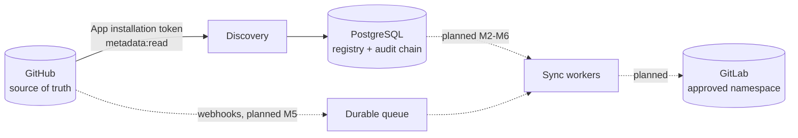

# ghgl-sync

A one-way, security-first synchronization engine: **GitHub → GitLab**. GitHub is the single source of
truth; nothing is ever pushed back.

> **Project status: early development (Milestones 0–1 of 8).**
> Repository **discovery and the registry work today**. Git mirroring, GitLab project creation,
> issue/PR/release sync, webhooks and the queue are **not built yet**. See [Status](#status) before
> relying on anything here. Nothing in this repository reports a feature as working unless it is.

## Contents

- [Status](#status)
- [How it works](#how-it-works)
- [Safety guarantees](#safety-guarantees)
- [Quick start](#quick-start)
- [GitHub App setup](#github-app-setup)
- [Configuration](#configuration)
- [CLI reference](#cli-reference)
- [Development](#development)
- [Security](#security)
- [Known limitations](#known-limitations)
- [Roadmap](#roadmap)
- [License](#license)

## Status

| Milestone | Scope | State |
|---|---|---|
| 0 | Scaffold, CI, threat model, config, log redaction, migrations | Done |
| 1 | GitHub App auth, paginated discovery, rate limits, registry, `discover` CLI | Done |
| 2 | GitLab client, namespace allow-list, project creation, conflict detection | Planned |
| 3 | Git mirror worker (refspec push, LFS, fsck, force-push/deletion handling) | Planned |
| 4 | Durable queue, per-repo locks, retries, dead-letter, scheduler | Planned |
| 5 | Webhook receiver (HMAC verification, dedupe) | Planned |
| 6 | Metadata sync: labels, milestones, issues, comments, releases, wiki, PRs | Planned |
| 7 | Metrics, status endpoint, `doctor`, alerts, audit export | Planned |
| 8 | Docker Compose, Actions profile, runbooks, compatibility matrix | Planned |

## How it works



Solid lines exist today; dashed lines are planned.

**Implemented flow (`ghgl-sync discover`):**

1. Take a session advisory lock so only one discovery runs at a time.
2. List the GitHub App's installations, then page through each installation's repositories using a
   token downscoped to `metadata: read`.
3. Reconcile the result into the registry in a single transaction: new repos, renames, transfers,
   visibility and archive changes, disappearance counting.
4. Append every change to a hash-chained audit log and commit. With `--dry-run`, run the identical
   path and roll back.

Design principles:

- **Identity is the GitHub numeric repo ID.** Names change; IDs don't.
- **Observation, not action.** A repo vanishing from GitHub is *recorded*, never acted on automatically.
- **Failures are loud.** A failed installation scan marks the run incomplete (exit code 7) instead of
  being silently skipped.

## Safety guarantees

Each of these is covered by automated tests.

| Guarantee | Behaviour |
|---|---|
| No false "deleted" verdicts | A repo is flagged `source_deleted` only after N (default 3) consecutive misses, and only for installations that scanned successfully. An empty installation list is treated as an anomaly. |
| No visibility widening | Config rejects policies like private→public. If a repo's policy would widen, it is held for human review and never applied automatically. Unknown visibility falls back to private. |
| Safe defaults | GitLab target visibility defaults to `private` for every source visibility, including public. |
| Tamper-evident audit | Append-only (database triggers reject UPDATE/DELETE/TRUNCATE) plus a SHA-256 hash chain; `audit verify` detects edits and deletions. |
| Secrets never surface | A central redactor scrubs logs, audit rows and error messages; secrets are `SecretStr`; config errors print field names only. |
| SSRF-resistant | Configured URLs must be public HTTPS; pagination refuses links off the API origin; redirects are never followed. |
| Idempotent | Re-scanning an unchanged account produces zero changes and zero writes. |

## Quick start

Requirements: Python 3.12+, PostgreSQL (tested only on 16), a registered GitHub App
(see [GitHub App setup](#github-app-setup)).

```bash
python3.12 -m venv .venv && source .venv/bin/activate
pip install --require-hashes -r requirements.lock   # hash-verified install
pip install --no-deps -e .

cp .env.example .env        # then edit: placeholders only, never commit real values
chmod 600 path/to/your-app-private-key.pem

ghgl-sync db migrate
ghgl-sync discover --dry-run   # preview, writes nothing
ghgl-sync discover
ghgl-sync status
ghgl-sync audit verify
```

There is no Docker Compose profile yet (Milestone 8). For a local database, `scripts/test-db.sh`
starts a throwaway PostgreSQL on Debian/Ubuntu (intended for tests, not production).

## GitHub App setup

Prefer a GitHub App over a personal access token; this project does not support PATs.

1. GitHub → Settings → Developer settings → **GitHub Apps** → New GitHub App.
2. **Webhook:** leave inactive for now (webhook ingestion arrives in Milestone 5).
3. **Repository permissions:** the current feature set (discovery) needs only **Metadata: Read-only**,
   which GitHub always grants. Grant nothing else yet. Later milestones will document the additional
   *read-only* permissions they need (Contents, Issues, Pull requests, and so on). Keep them read-only:
   that makes the one-way guarantee hold at the permission level.
4. Create the app, note the **App ID**, then **Generate a private key** and store the `.pem` somewhere
   outside the repository (`chmod 600`).
5. **Install** the app on the user/organization accounts you want synced, choosing "All repositories"
   or a selection.
6. Set `GHGL_GITHUB_APP_ID` and `GHGL_GITHUB_APP_PRIVATE_KEY_FILE` (see below). Set
   `GHGL_GITHUB_ALLOWED_OWNERS` to restrict which accounts are ever scanned.

Rotating the key: generate a new key in the app settings, update the file, then delete the old key in
GitHub. Installation tokens are held in memory only and refetched automatically.

## Configuration

All settings are environment variables prefixed `GHGL_` (a `.env` file is also read).

| Variable | Default | Purpose |
|---|---|---|
| `GHGL_DATABASE_URL` | required | PostgreSQL URL. Use `sslmode=require` outside local development. |
| `GHGL_GITHUB_APP_ID` | required | GitHub App ID |
| `GHGL_GITHUB_APP_PRIVATE_KEY_FILE` | | Path to the PEM key (preferred; must not be world-readable) |
| `GHGL_GITHUB_APP_PRIVATE_KEY` | | PEM contents (alternative; set only one of the two) |
| `GHGL_GITHUB_ALLOWED_OWNERS` | empty (all installations) | Comma-separated users/orgs authorized for sync |
| `GHGL_GITHUB_API_URL` | `https://api.github.com` | Override for GitHub Enterprise Server |
| `GHGL_GITHUB_API_VERSION` | `2022-11-28` | `X-GitHub-Api-Version` header |
| `GHGL_ALLOW_PRIVATE_NETWORK_HOSTS` | `false` | Permit a GHES host on a private network |
| `GHGL_ALLOW_INSECURE_HTTP` | `false` | Permit `http://` (local testing only) |
| `GHGL_FORK_POLICY` | `exclude` | `exclude` or `include` forks |
| `GHGL_ARCHIVED_POLICY` | `sync_readonly` | `sync_readonly` or `skip` |
| `GHGL_MISSING_SCANS_BEFORE_SOURCE_DELETED` | `3` | Consecutive misses before a repo is flagged |
| `GHGL_VISIBILITY_PRIVATE` / `_INTERNAL` / `_PUBLIC` | `private` / `private` / `private` | GitLab visibility per GitHub visibility. Widening is rejected. |
| `GHGL_HTTP_TIMEOUT_SECONDS` | `30` | Per-request timeout |
| `GHGL_MAX_RATE_LIMIT_WAIT_SECONDS` | `900` | Longer waits raise an error so a queue can reschedule |
| `GHGL_LOG_LEVEL` | `INFO` | JSON logs on stderr |

## CLI reference

Human-readable output goes to stdout, structured JSON logs to stderr. No command prints credentials.

| Command | Description |
|---|---|
| `ghgl-sync db migrate` | Apply pending migrations (checksum-verified, forward-only) |
| `ghgl-sync discover [--dry-run]` | Scan GitHub and reconcile the registry |
| `ghgl-sync status` | Registry counts by lifecycle/state, repos awaiting visibility review, last run |
| `ghgl-sync audit verify` | Verify the audit hash chain |

Further commands (`migrate --all`, `repository`, `run`, `reconcile`, `retry`, `audit` export, `doctor`)
arrive with the milestones that make them meaningful. They are intentionally not stubbed.

**Exit codes:** `0` ok · `2` configuration · `3` database · `4` migration · `5` discovery already
running · `6` GitHub failure · `7` scan incomplete · `8` audit chain broken.

## Development

```bash
scripts/test-db.sh                       # local throwaway PostgreSQL (Debian/Ubuntu)
export GHGL_TEST_DATABASE_URL='postgresql://postgres@/ghgl_test?host=/tmp&port=5433'

pytest -q                                # unit + database tests
ruff check . && ruff format --check .    # lint and format
mypy                                     # strict type checking
pip-audit -r requirements.lock --require-hashes --disable-pip
pre-commit install                       # ruff + secret scanning on commit
```

- Tests use a mocked GitHub API (`respx`) and a disposable PostgreSQL schema. They never contact real
  services or touch real repositories.
- Dependencies are pinned with hashes in `requirements.lock`. To regenerate:
  `uv pip compile pyproject.toml --extra dev --generate-hashes --python-version 3.12 -o requirements.lock`
- CI (`.github/workflows/`) runs lint, types, tests, dependency audit, secret scan and an SBOM, plus
  CodeQL. Actions are pinned to commit SHAs. These workflows have been validated but **not yet run on
  GitHub**.

## Security

- Threat model and control status: [`docs/THREAT_MODEL.md`](docs/THREAT_MODEL.md)
- Invariants, deletion policies, limitations: [`docs/DESIGN.md`](docs/DESIGN.md)

Never commit tokens, keys or `.env` files. If a credential is exposed, revoke it at the source
(GitHub App settings or GitLab token page) first, then rotate and redeploy. A full incident and
rotation runbook is planned for Milestone 8. To report a vulnerability, contact the maintainers
privately rather than opening a public issue (add a `SECURITY.md` with your contact before publishing).

## Known limitations

- **Only discovery exists.** No Git data, issues, PRs or releases are copied anywhere yet.
- **Deleted vs revoked** are not distinguished: a repo that vanishes while its installation still scans
  ends up `source_deleted` either way. A per-repo probe is planned for Milestone 4.
- **Fork de-duplication** works across installations by ID. Detecting a fork's parent is not
  implemented, because the installation listing doesn't expose it.
- **GitHub API version** is pinned to `2022-11-28`. Version `2026-03-10` has breaking changes to
  endpoints used here; migrating is a tracked task.
- **SSRF checks** validate literal hosts only; they do not defend against DNS rebinding. Use egress
  controls.
- **Audit chain** proves tampering only if its head hash is stored where a database admin can't
  rewrite it (export planned for Milestone 7).
- **GitLab fidelity limits** (authorship, original timestamps, reactions, merged-PR history) will be
  documented in a compatibility matrix in Milestone 8. GitLab cannot represent all GitHub fields, and
  full metadata parity will not be claimed.

## Roadmap

See the [Status](#status) table. Next up: **Milestone 2**, the GitLab client with a namespace
allow-list, ownership marker, conflict detection and dry-run migration preview.

## License

MIT. See [`LICENSE`](LICENSE).
